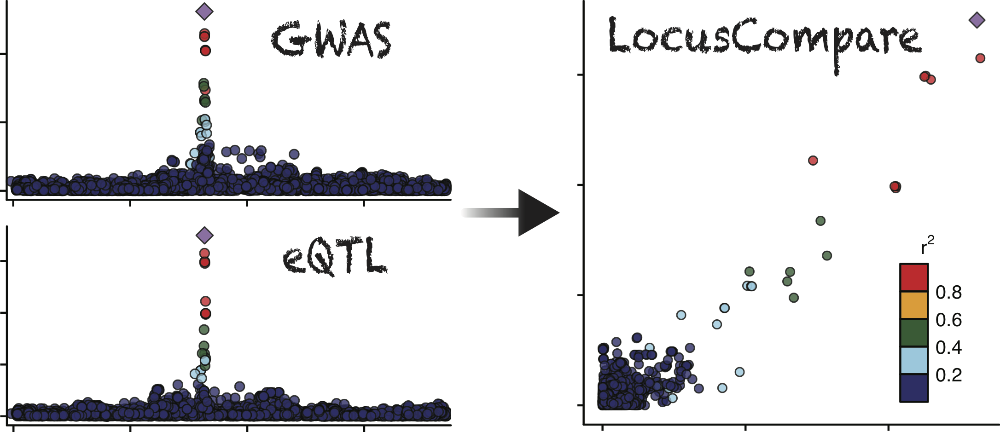

# LocusCompare

---
## Introduction

LocusCompare is an interactive tool for visualizing the colocalization of two genetic
association datasets (for example, a GWAS and an eQTL) at a single locus. Upload two sets of
summary statistics, choose a region by SNP, gene, or coordinate, and explore the shared
association signal with a LocusCompare scatter plot and two LocusZoom panels, colored by
linkage disequilibrium (1000 Genomes Phase 3).

Plots are produced by the [locuscomparer](https://github.com/boxiangliu/locuscomparer) R package.

## Looking for genome-wide colocalization?
For an ensemble of colocalization, TWAS, and Mendelian randomization methods across hundreds of
pre-loaded eQTL datasets, see **[LocusCompare2](https://locuscompare2.com)**.

## The LocusCompare family
- [locuscomparer](https://github.com/boxiangliu/locuscomparer) — R package
- [locuscomparepy](https://github.com/boxiangliu/locuscomparepy) — Python package
- [LocusCompare2](https://locuscompare2.com) — online ensemble GWAS-to-gene platform

## Citation
Liu B, Gloudemans MJ, Rao AS, Ingelsson E, Montgomery SB. *Abundant associations with gene
expression complicate GWAS follow-up.* Nature Genetics (2019).

## License
GPL v3 or later

## Developers
Boxiang Liu, Mike Gloudemans, Abhiram Rao, Stephen Montgomery
